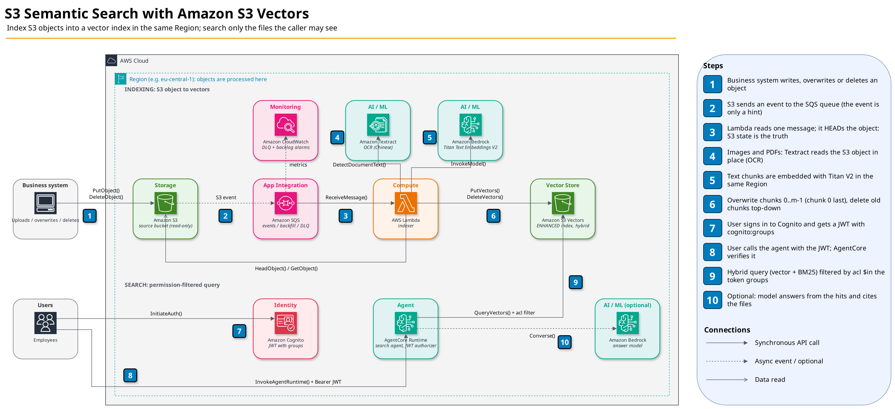

# s3-vectors-search

[中文](README_CN.md) · Explainer page: <https://liucao.me/s3/vectors/>

**Semantic search over the files in your S3 buckets with Amazon S3 Vectors.** How S3 Vectors works, what it costs, the basic APIs step by step, and one complete scenario demo (S3 objects → vectors → permission-filtered search → answers with sources).

> Sample code for learning, not an official AWS tool and not production ready. Check the AWS documentation for current limits and prices.

## What's inside

| You want | Go to |
|---|---|
| What S3 Vectors is, how to use it, limits and pitfalls | [docs/s3-vectors-guide.md](docs/s3-vectors-guide.md) (Chinese) |
| Pricing and a cost calculator | [docs/pricing.md](docs/pricing.md) · `tools/cost_estimate.py` |
| Basic APIs, one script per step | [examples/](examples/) |
| Scenario: S3 file search with permission filtering | [docs/architecture.md](docs/architecture.md) · [demo/](demo/) |
| The requirements behind the scenario | [docs/requirements.md](docs/requirements.md) |

## Basic API examples

Python 3.10+, boto3 1.44+, a Region with Bedrock Titan Text Embeddings V2.

```bash
pip install -r requirements.txt
cd examples
python 01_create.py --region eu-central-1 --bucket my-vectors-demo   # vector bucket + ENHANCED index (Chinese full-text)
python 02_put_query.py --bucket my-vectors-demo     # write + similarity query
python 03_filter.py --bucket my-vectors-demo        # metadata filters
python 04_hybrid.py --bucket my-vectors-demo        # scenario: error-code tickets, vector vs full-text vs hybrid
python 05_manage.py --bucket my-vectors-demo        # get, segmented list, delete
python 06_agent_memory.py --bucket my-vectors-demo  # scenario: agent long-term memory (user + time filters)
python 99_cleanup.py --bucket my-vectors-demo
```

## Scenario demo: S3 file semantic search



(Source: [docs/img/architecture.drawio](docs/img/architecture.drawio))

```
S3 bucket ─events→ SQS ─→ Lambda (extract / OCR / chunk / embed) ─→ S3 Vectors (ENHANCED, hybrid search)
                                                                        ▲
user ─Cognito JWT─→ AgentCore Runtime search agent ─filter by groups in the token─┘
```

- The current S3 state is the truth, so duplicate or out-of-order events can't leave wrong vectors; lost events are found by `reconcile.py`.
- Indexing one object never scans the whole index.
- Groups come only from the verified JWT, never from the request body.
- Failed messages go to a DLQ with an alarm. Backfill uses its own queue, so live updates are not slowed down.

```bash
python demo/deploy/deploy.py --region eu-central-1 --name s3vs --demo-users
python demo/deploy/deploy.py --region eu-central-1 --dry-run      # validate every API call offline
python demo/tools/e2e.py                                          # end-to-end test
python demo/tools/ask.py --user alice "年假有几天？"
python demo/deploy/deploy.py --region eu-central-1 --name s3vs --destroy
```

## Tests

`python -m pytest -q tests`: pipeline logic against in-memory fakes, deploy script and all examples in dry-run mode (every boto3 request validated against the service model), and the cost calculator checked against Examples 1 and 3 of the S3 pricing page.

## License

MIT-0
